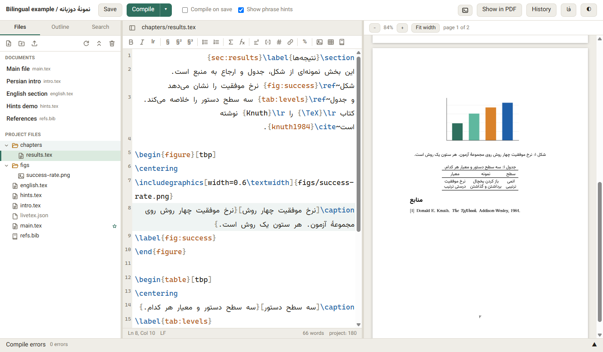
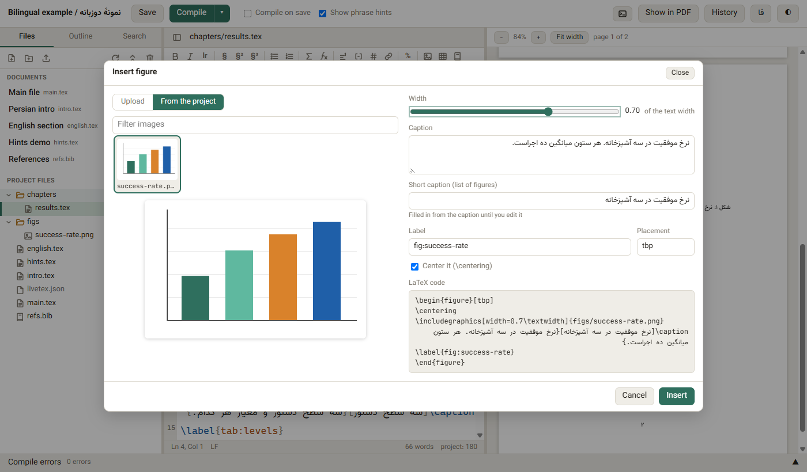
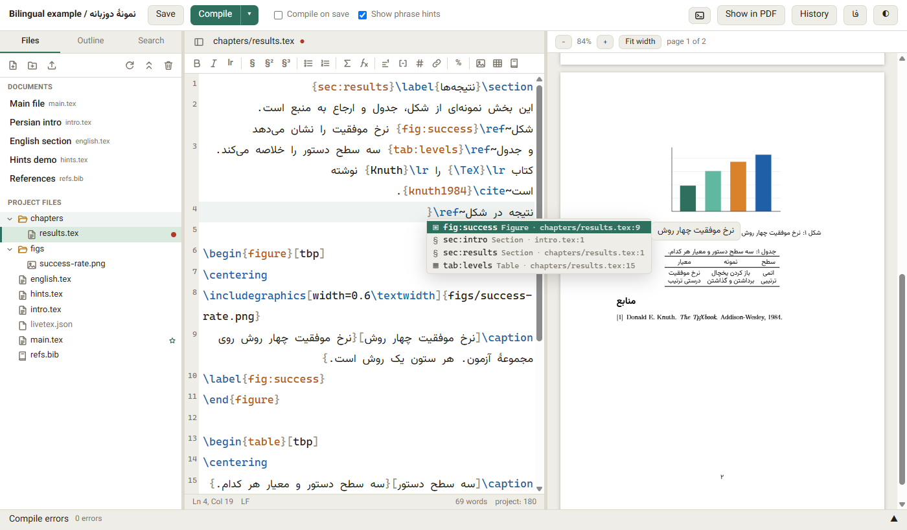
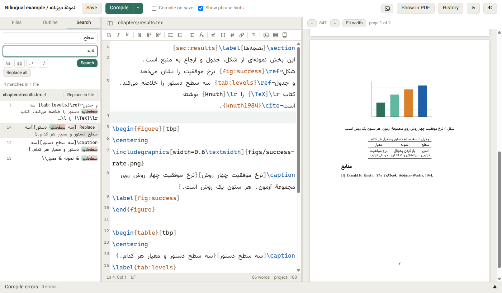
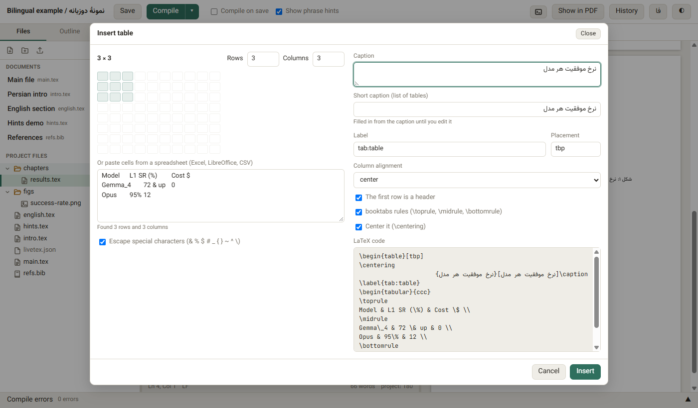
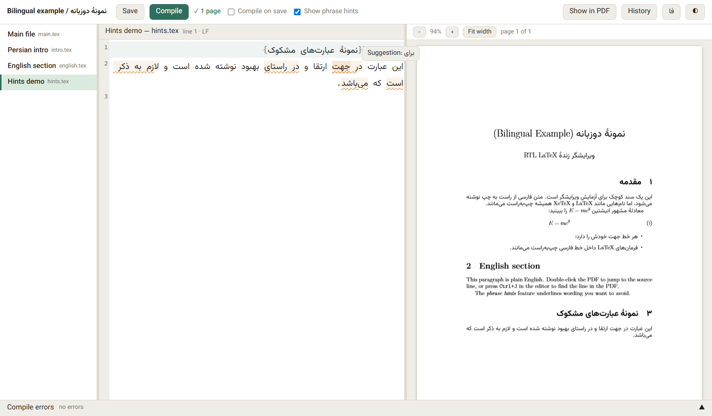
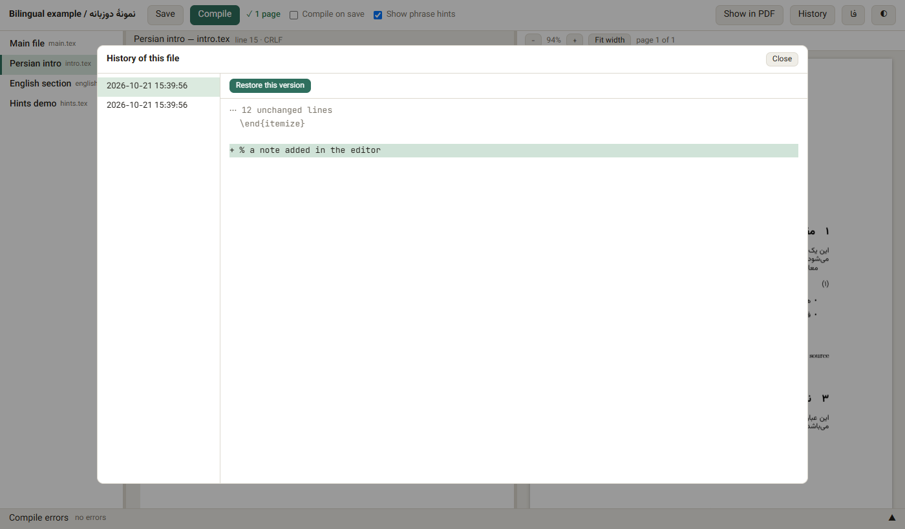
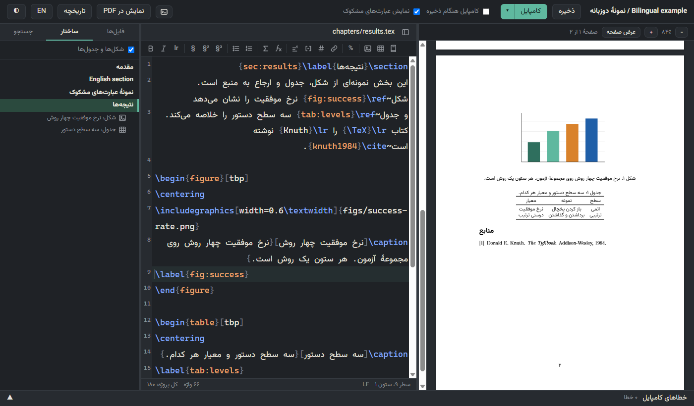

# RTL LaTeX Live Editor

A local, Overleaf-like LaTeX editor with first-class **right-to-left (Persian / Arabic / Hebrew)** support.
It runs on your own machine, edits the `.tex` files of a project in place, compiles with `latexmk`, and shows the PDF
next to the source. The server is a single Python file with no dependencies.



## Features

- **Per-line direction.** Every source line is shown right-to-left or left-to-right depending on its content, so
  `\item متن فارسی` reads RTL while `\begin{equation}` stays LTR. LaTeX command names and the arguments of
  `\label`, `\ref`, `\cite`, `\lr`, `\includegraphics`... do not count when deciding.
- **Commands stay left-to-right units.** Inside an RTL line every `\command` is isolated, so the backslash never jumps
  to the wrong end of the word.
- **SyncTeX both ways.** Double-click the PDF to jump to the source line; press `Ctrl+J` to find the cursor line in the PDF.
- **`latexmk` compile** (XeLaTeX, LuaLaTeX or pdfLaTeX) with a status badge, a clickable error list that opens the
  offending line, and the log tail.
- **Save history.** Every save keeps the previous version (last 200 per file) with a line diff and one-click restore.
- **Conflict detection.** If a file changes on disk (git, another editor) while you have unsaved edits, you get a banner
  instead of a silent overwrite; saves are refused with HTTP 409 if the base version is stale.
- **Phrase hints.** Underline wording you want to avoid, with a suggestion on hover. Hints come in packs
  (a JSON file); a Persian "plain wording" pack is included.
- **English and Persian UI** with a toggle in the page; light and dark themes; resizable panes.
- Preserves your files exactly: UTF-8, BOM and CRLF/LF are kept as they were.

### Project and writing tools (Overleaf-style)

- **Project file tree** (left panel, collapsible): every folder and file under the root, with the configured main
  documents listed first under their friendly names. Open any text file, preview images and PDFs, create files and
  folders, rename or move (double-click, the context menu, or drag a file onto a folder), and upload by dragging files
  from the desktop onto the tree or with the upload button. **Delete never deletes**: items go to
  `<root>/_edit_trash/<timestamp>/…` and the Trash dialog restores them. Renaming a file moves its save history too.
- **Insert figure**: toolbar button, drag an image into the editor, or paste one from the clipboard. Upload a new
  image (saved under `uploads`, default `figs/uploads/`, with a cleaned ASCII name and a `-1`, `-2` … suffix instead of
  overwriting) or pick one from a thumbnail grid of the project's images. Width as a fraction of `\textwidth`, caption,
  short caption for the list of figures (filled in from the caption until you edit it), label (`fig:` + name, kept
  unique), placement (`[tbp]`). Inserts `\begin{figure}…\caption[short]{long}\label{…}…\end{figure}` with a live code
  preview. PNG, JPG, PDF, EPS and SVG (SVG is inserted with `\includesvg`, which needs the `svg` package).
- **Insert table**: rows × columns grid picker, or paste cells from Excel / LibreOffice / CSV (special characters
  `& % $ # _ { } ~ ^ \` are escaped), header row, booktabs or `\hline` rules, column alignment, caption with short
  title, `tab:` label, `[tbp]`.
- **Formatting toolbar and shortcuts**: bold (`Ctrl+B`), italic (`Ctrl+I`), `\lr{}` for Latin text in a Persian line,
  section / subsection / subsubsection, bulleted and numbered lists, equation, inline math, footnote, `\cite`, `\ref`,
  `\href` / `\url`, comment or uncomment lines (`Ctrl+/`). With a selection the button wraps it (and unwraps it the
  second time). Tooltips in both UI languages.
- **Autocomplete**: `\ref{`, `\eqref{`, `\autoref{`, `\cref{`, `\pageref{` … list every `\label` with its file and
  caption or heading; `\cite{` (natbib / biblatex variants, several keys after commas) lists the `.bib` keys with author,
  year and title; `\includegraphics{` lists the project's images (also relative to `\graphicspath`); `\input{` lists
  `.tex` files; `\begin{` lists environments and adds the matching `\end{}`; plus common and project-defined commands.
- **Outline**: chapters, sections and subsections of every file included from the main file (`\input`, `\include`,
  `\subfile`, `\import`), with figures and tables by their captions; click to jump; the current section is highlighted.
- **Project-wide search and replace** (`Ctrl+Shift+F`): plain text or regular expression, match case, whole word,
  results grouped by file with context, replace one / in a file / everywhere with a preview and a confirmation. Every
  replacement is saved through the normal save path (a history copy, and a refusal if the file changed meanwhile);
  open files with unsaved edits are saved first. In regular-expression mode `$1`, `${name}` and `$&` refer to the
  match and backslashes are literal, so LaTeX needs no escaping. `Ctrl+F` / `Ctrl+H` search inside the current file.
- **Image hover preview** over an `\includegraphics{…}` path.
- **Word count** of the current file and of the whole document in the status bar (commands, comments, math, labels and
  citations are not counted; a Persian word with a zero-width non-joiner, such as «می‌شود», counts once).
- **Compile on save** toggle (remembered) and **Recompile from scratch** (`latexmk -C`, then compile) in the menu next
  to Compile.
- **Fast everyday compiles (XeLaTeX).** `latexmk` already reruns only the steps a change needs (BibTeX only when the
  citations change, and so on); on a long document most of the remaining time is `xdvipdfmx` compressing the PDF at its
  maximum level. The editor writes the preview PDF with light compression instead (`xdvipdfmx -z 1`): on a 120-page
  Persian thesis an edit-and-compile went from 52–89 s to about 10 s. **Final PDF (full quality)** in the same menu
  rewrites the PDF at full compression when you need the file to send. Hovering the status badge lists the files that
  changed since the last compile and says which kind of PDF is showing. Set `"fast_pdf": false` to turn this off.
- **New BibTeX entry** form (type, key suggested from author + year + title, authors, title, year, venue, DOI, URL)
  appended to a chosen `.bib` file through the normal save path, optionally inserting `\cite{key}` at the cursor.
- **Command palette** (`Ctrl+Shift+P` or `F1`) listing every action, and the editor remembers the open file and the
  cursor position in each file.











## Requirements

- Python 3.9 or newer (standard library only).
- A TeX distribution that provides `latexmk` and `synctex` on `PATH` (TeX Live, MiKTeX, MacTeX), plus the packages your
  document needs. The bundled example needs `xepersian` and works with XeLaTeX.
- A browser that can reach the internet: CodeMirror 6 (from `esm.sh`, pinned versions), PDF.js (from jsDelivr, pinned
  to 4.4.168) and the Vazirmatn font (Google Fonts) are loaded from CDNs.

## Quick start

```bash
git clone <this repository>
cd rtl-latex-live-editor
python server.py --root example --open        # the bundled bilingual example
```

Or use the launchers: `start-editor.bat` (Windows) / `./start-editor.sh` (macOS, Linux). Pass your project folder as the
first argument; with no argument the example opens.

For your own project, either point the server at the folder:

```bash
python server.py --root /path/to/my-paper --main paper.tex --port 8765
```

or drop a `livetex.json` into the project folder (it is picked up automatically) and run
`python server.py --root /path/to/my-paper`. If neither `--root` nor `--config` is given, `livetex.json` in the current folder is used, then one next to `server.py`
(handy when you vendor the editor into a repository). Then open <http://127.0.0.1:8765>.

The server listens on `127.0.0.1` only. Compiled output goes to `<root>/<outdir>/` (default `_live/`), save history to
`<root>/_edit_history/`, deleted files to `<root>/_edit_trash/`; add all three to your `.gitignore`.

**Which files the outline, completion and project search read.** Files reachable from the main file (through
`\input`, `\include`, `\subfile`, `\import`) always count. Other `.tex` and `.bib` files are added too, except those in
folders whose names start with `_` (drafts, archives, build folders); project search has a switch to include those.

**Safety.** Every path from the browser is checked to stay inside the root (no `..`, absolute paths, drive letters,
hidden or reserved names, or links that lead outside), and the output, history and trash folders cannot be written.
Writes are atomic (temporary file, then replace); uploads are limited to 25 MB and to known file types. Write requests
must come from the editor page itself (an `X-LiveTeX` header and an Origin/Host check), so another web site cannot
change your files through the local port.

## Config reference

A JSON file, `livetex.json` in the LaTeX project folder, or any path given with `--config FILE`. All keys are optional.
Relative paths are resolved against the folder that holds the config file. Unknown keys are rejected (typos get caught).

| key | default | meaning |
|---|---|---|
| `root` | the config's folder (or `--root`, or the current folder) | LaTeX project folder |
| `main` | `"main.tex"` | file passed to `latexmk` (a file name directly inside `root`) |
| `port` | `8765` | port on `127.0.0.1` |
| `title` | root folder name | shown in the top bar and tab title |
| `engine` | `"xelatex"` | `"xelatex"`, `"lualatex"` or `"pdflatex"` |
| `order` | `[]` | file names listed first, in this order; the rest follow alphabetically |
| `names` | `{}` | display names, `{"fasl1.tex": "Chapter 1"}` |
| `extensions` | `[".tex", ".bib"]` | extensions of the root-level files listed under "Documents" (the file tree shows everything; text files with `.tex .bib .sty .cls .md .txt .csv .bst .def .cfg .clo` and similar are editable anywhere in the project) |
| `uploads` | `"figs/uploads"` | folder (relative to the root) where images uploaded from the Insert figure dialog are saved |
| `outdir` | `"_live"` | `latexmk -outdir` folder name |
| `fast_pdf` | `true` | XeLaTeX only: write the preview PDF with light compression (much faster); **Final PDF** gives the full-quality file |
| `hints` | `[]` | phrase-hint packs: built-in names (`"fa-plain-persian"`) or file paths |
| `ui` | `"en"` | UI language, `"en"` or `"fa"` (the in-page toggle overrides it for that browser) |

Command line (overrides the config): `--root DIR`, `--main FILE`, `--port N`, `--config FILE`, `--open` (launch the browser).

Example:

```json
{
  "main": "paper.tex",
  "title": "My paper",
  "engine": "xelatex",
  "ui": "fa",
  "order": ["paper.tex", "intro.tex", "refs.bib"],
  "names": {"paper.tex": "Main file", "intro.tex": "Introduction"},
  "hints": ["fa-plain-persian", "my-hints.json"]
}
```

## Keyboard shortcuts

| keys | action |
|---|---|
| `Ctrl+S` | save |
| `Ctrl+Enter` | save and compile |
| `Ctrl+J` | show the cursor line in the PDF |
| `Ctrl+F` / `Ctrl+H` | find / find and replace in the current file |
| `Ctrl+Shift+F` | search and replace in the whole project |
| `Ctrl+B` / `Ctrl+I` | bold / italic (wraps the selection; again to unwrap) |
| `Ctrl+/` | comment or uncomment the selected lines |
| `Ctrl+Space` | open the completion list |
| `Ctrl+Shift+P` or `F1` | command palette |
| `Ctrl+Z`, `Ctrl+Shift+Z` | undo / redo |
| double-click in the PDF | jump to the source line |
| double-click a file in the tree | rename or move it |

On macOS use `Cmd` in place of `Ctrl`.

## How hints work

A hint pack is a JSON list of `{"pattern", "hint", "re"?}` objects (or an object with a `"phrases"` list):

```json
[
  {"pattern": "in order to", "hint": "to"},
  {"pattern": "\\butilis(e|ing)\\b", "hint": "use", "re": true}
]
```

`pattern` is matched literally, or as a JavaScript regular expression when `"re": true`. Matches are underlined while
you type; hovering shows `Suggestion: <hint>`. A pack is found by name in `hints/<name>.json`, or by path relative to
the config file. Several packs can be combined. The checkbox "Show phrase hints" turns underlining off.

`hints/fa-plain-persian.json` flags stiff, formal or machine-sounding Persian wording (for example «می‌باشد» → «است»).



The UI switches between English and Persian (right-to-left layout):



## Tests

```bash
python selftest.py
```

Covers config loading and validation, path safety (traversal, protected folders, links leaving the root), CRLF/LF/BOM
round trips, the 409 conflict and concurrent saves, history, the file tree, new file / folder, rename with history,
trash and restore, upload naming and limits, the label / citation / outline index, word count, project search and
replace, BibTeX entries, log and SyncTeX parsing, hint packs, the HTTP guards, and that every UI string exists in both
languages. If `node` is installed it also checks the browser-side LaTeX helpers (`static/latex-tools.js`). It needs no
TeX installation and works only on temporary folders.

## Limitations

- Single user, local only. There is no login and no collaboration; do not expose the port to a network.
- Files must be UTF-8.
- Caption and other text fields in the dialogs are plain inputs: a LaTeX command inside Persian text can look reordered
  while you type it there (the code preview under the fields shows it the way the editor does).
- The error list is parsed from `-file-line-error` output; errors that LaTeX does not attribute to a line show without a location.
- Compilation uses `latexmk` with the options in `server.py`; custom `latexmkrc` settings in the project still apply,
  except that with `fast_pdf` on (the default) the editor's own rc, read last, sets `$xdvipdfmx`.
- The PDF is redrawn after every compile, not incrementally; very large documents take a moment.
- Needs internet access for CodeMirror, PDF.js and the font (they are not bundled).

## بخش فارسی

**ویرایشگر زندهٔ LaTeX با پشتیبانی کامل از راست‌به‌چپ.** برنامه‌ای محلی، شبیه Overleaf، که فایل‌های `.tex` پروژهٔ شما را
روی همان رایانه ویرایش می‌کند، با `latexmk` کامپایل می‌کند و PDF را کنار متن نشان می‌دهد. سرور فقط یک فایل پایتون است و به
هیچ بستهٔ اضافه‌ای نیاز ندارد.

- جهت هر خط جدا تشخیص داده می‌شود (فارسی از راست، فرمان‌ها از چپ) و هر `\command` یک واحد چپ‌به‌راست می‌ماند.
- SyncTeX دوطرفه: دوبار کلیک در PDF شما را به خط منبع می‌برد، و `Ctrl+J` خط فعلی را در PDF نشان می‌دهد.
- تاریخچهٔ ذخیره، تشخیص تعارض هنگام تغییر فایل بیرون از ویرایشگر، فهرست خطاهای کامپایل.
- عبارت‌های مشکوک با بستهٔ قابل‌افزودن زیر خط کشیده می‌شوند؛ بستهٔ «فارسی ساده» همراه برنامه است.
- رابط انگلیسی یا فارسی (کلید `فا` / `EN` در نوار بالا، یا `"ui": "fa"` در پیکربندی).
- کامپایل سریع با XeLaTeX: هنگام ویرایش، PDF با فشرده‌سازی سبک ساخته می‌شود (در یک پایان‌نامهٔ ۱۲۰ صفحه‌ای، از ۵۲ تا ۸۹ ثانیه به حدود ۱۰ ثانیه رسید). گزینهٔ «PDF نهایی (کیفیت کامل)» در منوی کامپایل، فایل کامل را برای فرستادن می‌سازد. نگه داشتن نشانگر روی وضعیت کامپایل، فایل‌های تغییرکرده از کامپایل قبلی را نشان می‌دهد.
- درخت فایل‌های پروژه: ساختن فایل و پوشه، تغییر نام و جابه‌جایی، بارگذاری با کشیدن فایل؛ حذف هیچ‌وقت قطعی نیست و فایل به
  سطل بازیافت (`_edit_trash`) می‌رود و از همان‌جا برمی‌گردد.
- افزودن شکل (بارگذاری، کشیدن یا چسباندن تصویر) و جدول (با جدول‌ساز یا چسباندن از Excel) با عنوان کوتاه و برچسب.
- نوار قالب‌بندی، تکمیل خودکار `\ref` و `\cite` و `\includegraphics` و `\begin`، ساختار سند، جستجو و جایگزینی در کل
  پروژه، پیش‌نمایش تصویر، شمارش واژه (با نیم‌فاصله درست شمرده می‌شود)، فرم منبع تازهٔ BibTeX و فهرست فرمان‌ها (`Ctrl+Shift+P`).

اجرا:

```bash
python server.py --root example --open
```

برای پروژهٔ خودتان یک فایل `livetex.json` در پوشهٔ پروژه بگذارید (کلیدها در جدول بالا) و `python server.py --root پوشه-پروژه` را بزنید.
نیازمندی‌ها: پایتون ۳٫۹ به بالا، `latexmk` و `synctex` روی `PATH`، و اینترنت برای بارگذاری CodeMirror و PDF.js و فونت.

## License

MIT, copyright 2026 Arash NasrEsfahani. See [LICENSE](LICENSE).
